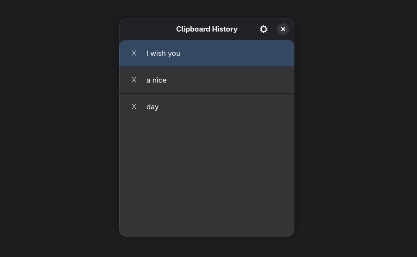

# Pasty

A modern, simple, and lightweight clipboard manager written in Python, GTK4, and Libadwaita.
Designed to integrate cleanly with the GNOME desktop environment on Linux.



## Features

* **Native Design:** Clean interface following GNOME Human Interface Guidelines (Libadwaita).
* **Persistent History:** Safely preserves your clipboard history across reboots.
* **Pinned Items:** Pin frequently used clips to the top so they are never purged.
* **Instant Search:** Type-to-search to quickly filter through your clipboard history.
* **Keyboard-First Workflow:** Navigate with arrow keys, copy with `Enter` or `Alt+1..9`, pin with `Ctrl+P`, delete with `Del`.
* **Clear History:** One-click clear for regular clips while keeping your pinned items intact.
* **Smart Filtering:** Automatically ignores duplicates and consecutive identical copies.
* **Multi-Language Support:** Automatically detects system language (English, Italian, French, Spanish, German) with English fallback.
* **Global Shortcut:** Integrates seamlessly with custom system shortcuts (recommended: `Alt+V`).
* **Configurable:** Choose how many items to keep in memory.

## Requirements

* Python 3.10+
* GTK4 and Libadwaita
* Fedora Workstation (Recommended) or other Linux distributions with GNOME

## Installation (Tested on Fedora + GNOME)

1. **Clone the repository:**
   ```bash
   git clone https://github.com/Negatorto/pasty.git
   cd pasty
   ```

2. **Install system dependencies:**
   ```bash
   sudo dnf install python3-gobject gtk4 libadwaita python3-pip
   ```

3. **Optional: Create a virtual environment and install dependencies:**
   ```bash
   python3 -m venv venv
   source venv/bin/activate
   ```

## Autostart (Run in Background)

To have Pasty start automatically at login and monitor your clipboard in the background:

1. **Create the autostart directory if it doesn't exist:**
   ```bash
   mkdir -p ~/.config/autostart
   ```

2. **Create the desktop entry file:**
   ```bash
   nano ~/.config/autostart/pasty.desktop
   ```

3. **Paste the following content** (replace `/absolute/path/to/pasty/` with your actual path):
   ```ini
   [Desktop Entry]
   Type=Application
   Name=Pasty Background
   Comment=Clipboard Manager
   Exec=/absolute/path/to/pasty/pasty.sh --silent
   Icon=edit-paste
   Hidden=false
   NoDisplay=false
   X-GNOME-Autostart-enabled=true
   ```

## Shortcut Configuration

To open Pasty instantly using a keyboard shortcut (e.g. `Alt + V`):

1. Open **Settings** > **Keyboard** > **View and Customize Shortcuts**.
2. Select **Custom Shortcuts**.
3. Add a new shortcut pointing to the `pasty.sh` script (without the `--silent` flag):
   * **Name:** Pasty
   * **Command:** `/absolute/path/to/pasty/pasty.sh`
   * **Shortcut:** `Alt + V` *(Recommended on GNOME: avoids conflicts with the Super/Activities key)*

Ensure `pasty.sh` has execution permissions:
```bash
chmod +x pasty.sh
```

## License

This project is licensed under the **GNU General Public License v3.0** - see the [LICENSE](LICENSE) file for details.

